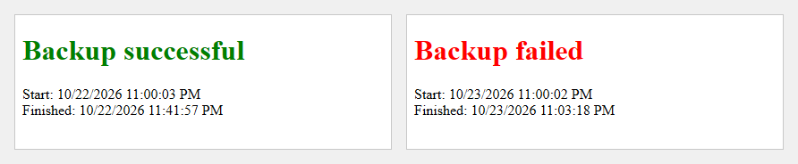

# Self-healing backups

Three small PowerShell scripts that keep Windows Server Backup running without anyone watching it:
one emails a report after each backup and kicks off a repair when the backup failed, one repairs
the Volume Shadow Copy (VSS) writers that usually cause those failures, and one runs a one-off
backup of a data drive to a network share.

## What it does

- **Backup Report** (`Backup Reports/Backup Report.ps1`) emails an HTML report of the last
  Windows Server Backup job, with a green "Backup successful" or red "Backup failed" heading and
  the job's start and finish times. When the backup failed, it also starts VSS Repair.
- **VSS Repair** (`VSS Repairs/VSSRepair.ps1`) finds every VSS writer that reports an error and
  restarts the Windows service behind it.
- **D Drive Backup** (`D_Drive Backup/D_Drive Backup.ps1`) backs up one volume to a network share
  straight away, without touching the scheduled backup.

## How it works

The three scripts form a small loop around the nightly Windows Server Backup job.

1. **The backup runs** on its normal schedule. Most failures come from a VSS writer stuck in a
   failed state: Windows Server Backup works from a VSS shadow copy, VSS asks each writer (SQL
   Server, WMI, the registry and so on) to put its data in a consistent state for it, and one
   writer in a bad state can fail the whole job.
2. **Backup Report runs after it** from Task Scheduler. It reads the job's start and end times
   with `Get-WBJob -Previous 1`, and the result with `Get-WBSummary`: a `LastBackupResultHR` of 0
   (an HRESULT meaning success) is a successful backup, anything else a failure. It builds the
   email as an HTML here-string, using the result word (`successful` or `failed`) both in the
   heading and as its CSS class, which colors it green or red. Below the times it adds the job's own
   success or failure log, read from the paths `Get-WBJob` reports and HTML-encoded line by line,
   and sends it with `Send-MailMessage`.
3. **On a failure it starts VSS Repair** with `Start-Process` before sending the email, so the
   repair runs alongside the report instead of holding it up.
4. **VSS Repair resets the broken writers.** It runs `vssadmin list writers` and uses
   `Select-String` with five lines of context after each `Writer name:` line to read that writer's
   block; the fourth line after the name is its `Last error`. For each writer whose last error is
   not "No error", it takes the name from between the quotes and looks up the service that hosts
   it in a table of 27 common writers (for example `SqlServerWriter` is `SQLWriter`, `WMI Writer`
   is `Winmgmt`, and several writers live in the VSS service itself), then restarts that service.
   It finishes by restarting Cryptographic Services (the host of the System Writer), making sure
   WMI is running and stopping the SQL Server VSS Writer service.
5. **The next scheduled backup** then starts with the writers reset, so it has a good chance of
   working without anyone stepping in, and the next report shows whether it did.

**D Drive Backup** sits beside the loop. It builds a backup policy in memory (`New-WBPolicy`,
`Add-WBVolume`, `Add-WBBackupTarget` with a `New-WBBackupTarget -NetworkPath` share) and runs it
with `Start-WBBackup`. The policy is never saved with `Set-WBPolicy`, so the scheduled backup is
left as it was. It goes through the same Windows Server Backup engine, so if it is the last job to
run before Backup Report, the report covers it.

**Launchers.** Each script has a `.bat` file with the same name that runs
`PowerShell.exe -ExecutionPolicy Bypass` on `%~dpn0.ps1`: the batch file's own drive, folder and
name with `.ps1` on the end. Each launcher runs the script next to it wherever the folder is
copied, from a double-click or from Task Scheduler, without changing the machine's execution
policy.

## How to run it

You need Windows Server with the Windows Server Backup feature installed (it provides the
`Get-WBJob`, `Get-WBSummary` and `Start-WBBackup` commands), and an administrator account.

1. Copy the three folders to the server.
2. Open `Backup Reports/Backup Report.ps1` and change the settings at the top:
   - `$OfficeName`: the name shown in the email subject, such as `Office Name: Backup Report`.
   - `$MailMessageTo`, `$MailMessageFrom`: who gets the report and who it comes from.
   - `$MailMessageSMTPServer`: a mail server that accepts mail from this server without a login.
   - `$VSSRepairPath`: where you put `VSSRepair.bat`.
3. Open `D_Drive Backup/D_Drive Backup.ps1` and set `$SourceVolume` (the drive to back up) and
   `$BackupShare` (the network share, such as `\\SERVER\Backups`).
4. In Task Scheduler, run `Backup Report.bat` as an administrator after the nightly backup
   finishes.
5. Run `D_Drive Backup.bat` whenever you want an extra copy of the drive.

`VSSRepair.bat` can also be run by hand whenever `vssadmin list writers` shows a writer in a
failed state.

## License

MIT. See [LICENSE](LICENSE).
